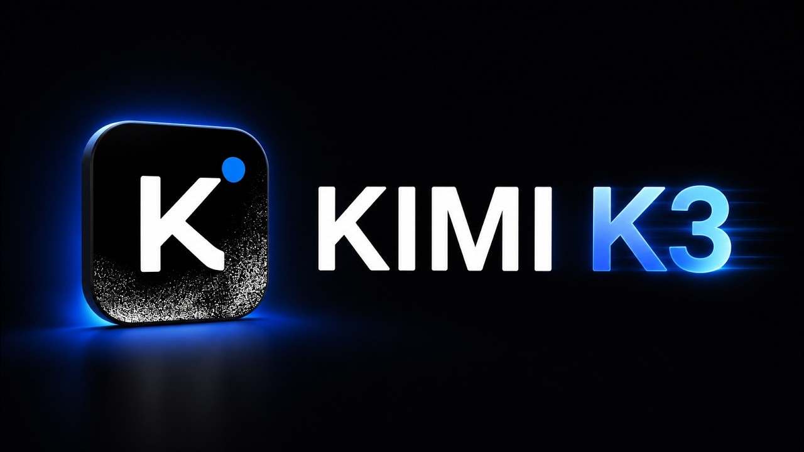
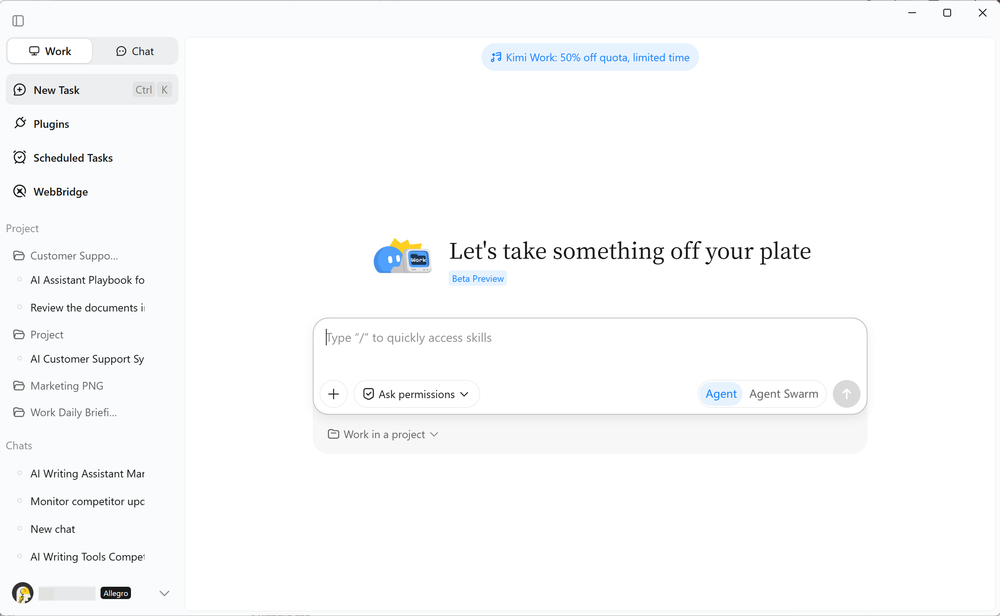
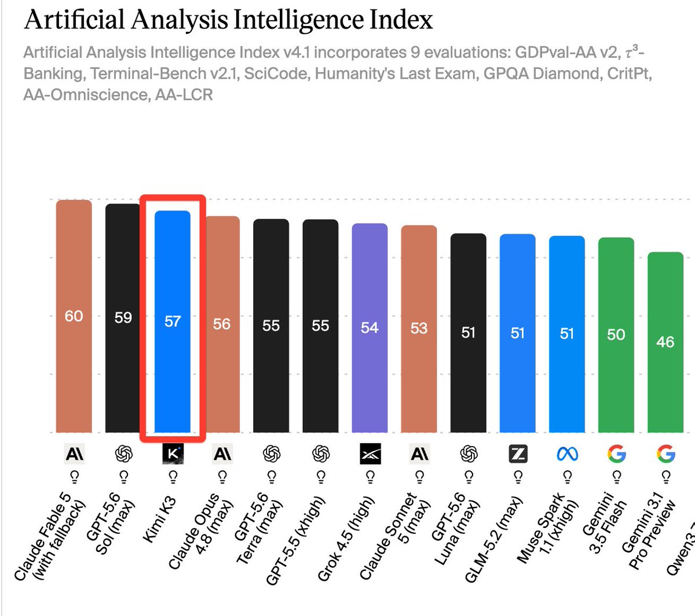
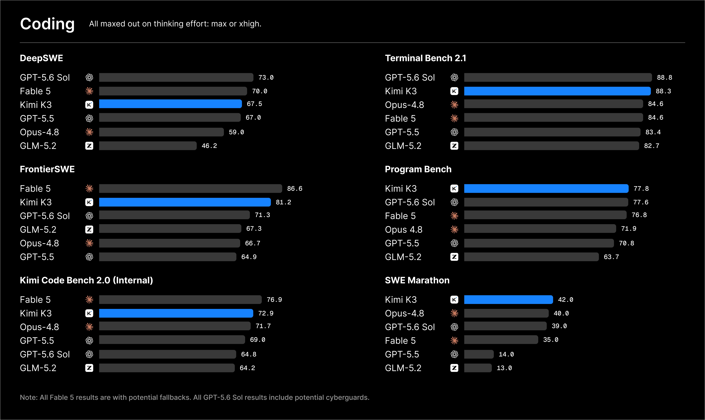
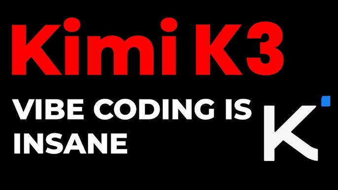

# Kimi K3 Code Free Desktop

**Kimi K3 Code Free Desktop** v2.1 (August 26, 2026) is a Moonshot kimi k3 coding client. is kimi k3 free? The desk rides the free tier. kimi k3 huggingface holds weights. kimi k3 vs fable 5 is the bilingual 1M lane.

## What's new in v2.1 (August 26, 2026)
- Faster repo scans
- PR review comments optional
- CJK in code blocks fixed
- Diff view for suggested patches

## Key Features
- kimi k3 coding model, 1M context
- GitHub repos, PR review, commit text
- Review: bugs, security notes, refactors
- Scanner maps a project in one pass
- Python, JS/TS, C++, Java, Go, Rust, C#, PHP
- Chinese + English without a translator
- Markdown / JSON export

## Getting Started
1. Get v2.1.
2. Run `KimiK3Desktop.exe`.
3. Paste a Moonshot API key from platform.moonshot.cn.
4. Paste code or open a GitHub repo.
5. Notes in `files/notes/`.

## FAQ

**Is kimi k3 free?**
The client is MIT. Moonshot's free tier covers personal coding.

**Open weights?**
Licensing lives on kimi k3 huggingface.

**Kimi k3 vs fable 5?**
K3 wins long-context bilingual repos. Fable 5 leans English creative work.

## Requirements
4 GB RAM. Internet for API calls.

## License
MIT License - Copyright (C) 2026 kimik3codemoonshot

